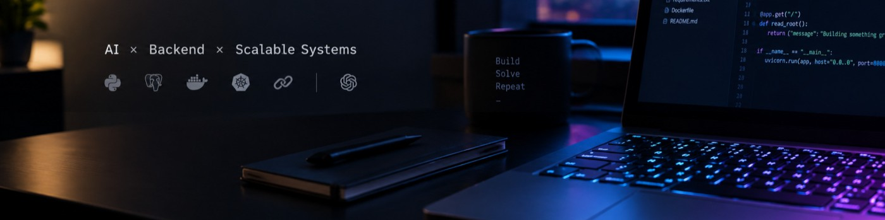

<!-- Custom Cover Banner -->

  

 

<!-- Centered Personal Greeting -->

  <h1>Hi, I'm Anish 👋</h1>
  

<!-- Links & Live Profile Views -->

  
  
  
  

 

<!-- Personal Centered Intro -->

  I'm an <b>AI Engineer</b> from Mumbai who loves building <b>LLM agents</b>, fast <b>Python backends</b>, and clean automation pipelines. 
  I enjoy taking messy problems from idea to production — whether that's tuning multi-LLM orchestration, 
  containerizing microservices, ricing Linux/Hyprland setups, or sharpening my system design &amp; DSA. 
  Always down to collaborate on interesting AI or backend builds ✨

---

### ⚡ Tech Stack

<!-- AI / LLM -->

<!-- Backend & Databases -->

<!-- DevOps & Cloud -->

---

### 📊 My GitHub Stats

  

<!-- Dynamic Purple Contribution Snake (from your GitHub Action) -->
<picture>
  <source media="(prefers-color-scheme: dark)" srcset="https://raw.githubusercontent.com/Xerp839/Xerp839/output/github-snake-dark.svg" />
  <source media="(prefers-color-scheme: light)" srcset="https://raw.githubusercontent.com/Xerp839/Xerp839/output/github-snake.svg" />
  
</picture>

